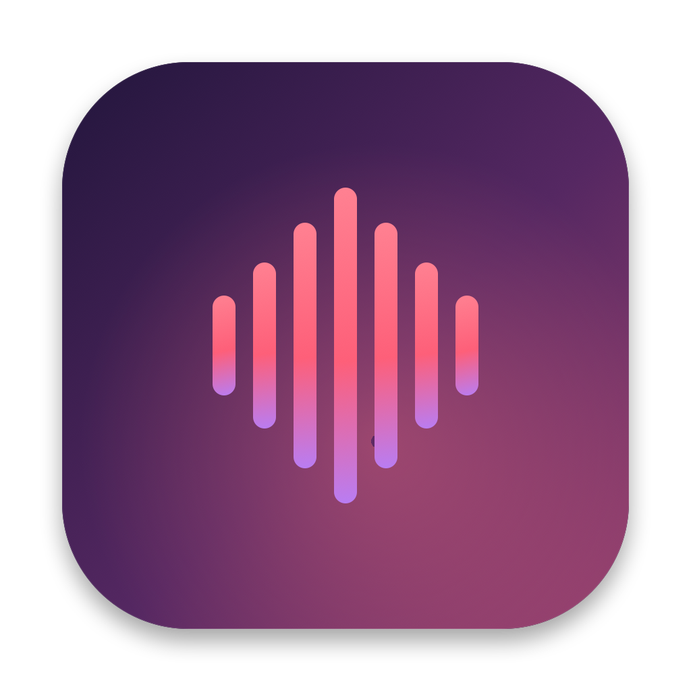

<p align="center">
  
</p>

<h1 align="center">Cadence for macOS</h1>

<p align="center">A native, keyboard-first browser for your Apple Music library. No Electron.</p>

<p align="center"><a href="https://github.com/alexandryasukaitisss-cmd/cadence-macos/actions/workflows/ci.yml"></a></p>

Cadence opens your Music.app library in a fast native window: songs, albums, artists, playlists, search, favorites, recently added, and artwork. It keeps a local copy of the library, so the window opens quickly and shows something even before Music starts.

Playback stays in Music.app. Your Apple Music subscription, Lossless, and Dolby Atmos settings keep working as Apple implements them; Cadence only sends play, pause, next, and seek commands.

Version 0.1.0. macOS 14 or newer. Not affiliated with Apple.

Русская версия: [README.ru.md](README.ru.md).

## What is in this release

- Native Music library browser with cached startup.
- Songs, albums, artists, playlists, search, favorites, frequently played, recently added, and recently played.
- Command palette (`⌘K`), keyboard shortcuts, mini-player, and menu-bar controls.
- Artwork cache with a local disk cache and an explicit fallback to Music.app.
- Optional Apple Podcasts shortcut: opens the official catalog in your browser.

## What is not in this release

- No embedded Apple Podcasts player, login, or sync. Those need a separate review of Apple's rules and a real 2FA flow.
- No automatic playlist creation or deletion in your Music library.
- No system-wide media-key takeover or Now Playing registration. Cadence controls playback inside its own window; Music.app keeps its own system integration.
- No DRM bypass, no downloaded catalog, no Apple Music web player. Playback is a command to Music.app.

## Requirements

- macOS 14 or newer.
- Xcode 16 or newer with Swift 5.9+ (macOS 27 / Swift 6.4 was used for the release check).
- Music.app with your library and an Apple Music subscription for subscription tracks.
- No Apple Developer account is required for a local ad-hoc build.

## Build

```sh
git clone https://github.com/alexandryasukaitisss-cmd/cadence-macos.git
cd cadence-macos
swift test --scratch-path /tmp/cadence-test
./scripts/build_app.sh
open build/Cadence.app
```

`build_app.sh` creates an ad-hoc-signed app at `build/Cadence.app`. If the checkout is inside a File Provider/iCloud folder, codesign can see Finder metadata; set an output path outside it:

```sh
CADENCE_APP_DIR="$HOME/Applications/Cadence.app" ./scripts/build_app.sh
```

The app is not notarized. On first launch, right-click → **Open**, or remove the quarantine flag:

```sh
xattr -dr com.apple.quarantine build/Cadence.app
```

## First run

1. Cadence shows the onboarding screen.
2. Choose **Подключить Music и начать** if you want the library. macOS asks for Automation access to Music.
3. If you choose **Продолжить без Music**, Cadence shows the app without a library. You can connect later in Settings.
4. The library is cached in `~/Library/Application Support/Cadence/library.json`. Opening Cadence does not launch Music; it shows the cache until you press Play or connect explicitly.

If Automation is denied, Cadence stops polling Music and shows a banner. Grant access in **System Settings → Privacy & Security → Automation**, then press **Подключить** again.

## How it works

```text
SwiftUI
├── CadenceCore
│   ├── AppleScriptMusicLibraryService — batch library read, two Apple events
│   ├── MusicLibraryCache — atomic JSON cache
│   ├── MusicLibraryIndex — grouping and search
│   ├── AppleScriptMusicArtworkService — artwork data
│   └── CatalogSearchService — iTunes Search API for catalog links
└── Cadence
    ├── MusicController — AppleScript commands and now-playing polling
    ├── PlaybackCoordinator — now-playing state and artwork
    ├── ArtworkStore — memory and disk cache
    └── SwiftUI views — library, player, palette, settings
```

Music library reads are batched: one Apple event for track columns and one for playlists, not one request per track. Play and reveal use the track's persistent ID when available; a cached database ID is only a fallback.

## Tests

The public tree has 27 deterministic tests. They cover AppleScript descriptor parsing, playlist persistent IDs, cache compatibility, search, and catalog response mapping. They do not start Music or touch your library.

```sh
swift test --scratch-path /tmp/cadence-test
```

The release check also builds the app, verifies the ad-hoc signature, and launches it against a real Music library. Those manual checks are listed in the release notes.

## Privacy and Apple

- Cadence has no telemetry, account, or backend.
- The library cache and artwork cache stay on your Mac.
- Cadence does not read or store your Apple Account password. Podcasts open in your browser, where Apple handles the session.
- Apple Music and Apple Podcasts are trademarks of Apple Inc. Cadence is an independent project and is not affiliated with or endorsed by Apple.
- Cadence does not bypass DRM. It sends playback commands to Music.app.

## License

MIT. See [LICENSE](LICENSE).
