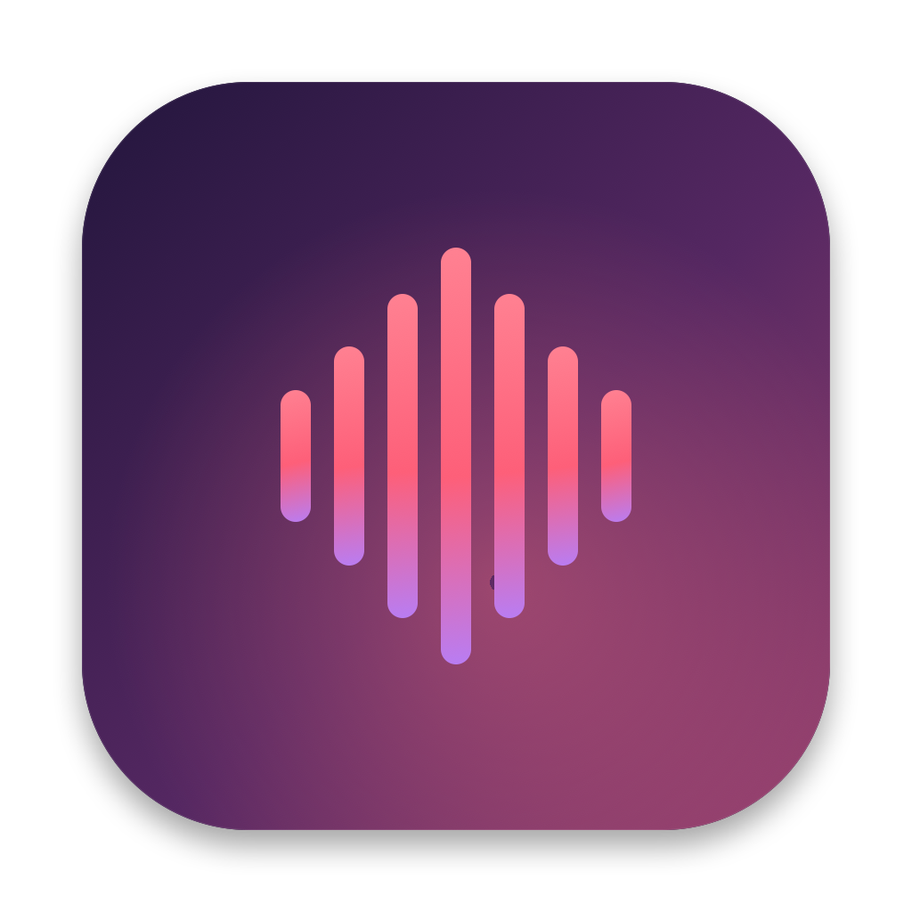

<p align="center">
  
</p>

<h1 align="center">Cadence для macOS</h1>

<p align="center">Нативный браузер медиатеки Apple Music с клавиатурным управлением. Без Electron.</p>

Cadence открывает вашу медиатеку Music.app в быстром нативном окне: песни, альбомы, исполнители, плейлисты, поиск, любимые треки, недавно добавленные и обложки. Он хранит локальную копию медиатеки, поэтому окно открывается быстро и показывает данные ещё до запуска Music.

Воспроизведение остаётся в Music.app. Подписка Apple Music, Lossless и Dolby Atmos работают так, как их реализует Apple; Cadence только отправляет команды play, pause, next и seek.

Версия 0.1.0. macOS 14 или новее. Проект не связан с Apple.

English version: [README.md](README.md).

## Что входит в релиз

- Нативный браузер медиатеки Music с кэшем при запуске.
- Песни, альбомы, исполнители, плейлисты, поиск, любимые, часто играющие, недавно добавленные и недавно игравшие.
- Командная палитра (`⌘K`), горячие клавиши, мини-плеер и меню-бар.
- Кэш обложек: память и диск, с явным обращением к Music.app.
- Необязательный переход в Apple Podcasts: официальный каталог открывается в браузере.

## Чего в релизе нет

- Встроенного плеера Apple Podcasts, входа и синхронизации. Для них нужны отдельная проверка правил Apple и реальный сценарий 2FA.
- Автоматического создания и удаления плейлистов в вашей медиатеке.
- Захвата системных медиаклавиш и регистрации Now Playing. Cadence управляет воспроизведением в своём окне; системная интеграция остаётся у Music.app.
- Обхода DRM, скачивания каталога и веб-плеера Apple Music. Воспроизведение — это команда Music.app.

## Требования

- macOS 14 или новее.
- Xcode 16 или новее, Swift 5.9+ (релиз проверен на macOS 27 / Swift 6.4).
- Music.app с вашей медиатекой и подпиской Apple Music для подписочных треков.
- Apple Developer Account для локальной ad-hoc сборки не нужен.

## Сборка

```sh
git clone https://github.com/alexandryasukaitisss-cmd/cadence-macos.git
cd cadence-macos
swift test --scratch-path /tmp/cadence-test
./scripts/build_app.sh
open build/Cadence.app
```

`build_app.sh` собирает приложение с ad-hoc подписью в `build/Cadence.app`. Если проект лежит в папке File Provider/iCloud, codesign может увидеть метаданные Finder; задайте путь вне неё:

```sh
CADENCE_APP_DIR="$HOME/Applications/Cadence.app" ./scripts/build_app.sh
```

Приложение не нотаризовано. При первом запуске: правый клик → **Open**, либо снимите quarantine:

```sh
xattr -dr com.apple.quarantine build/Cadence.app
```

## Первый запуск

1. Cadence показывает онбординг.
2. Нажмите **Подключить Music и начать**, если нужна медиатека. macOS запросит доступ Automation к Music.
3. Если выбрать **Продолжить без Music**, приложение откроется без медиатеки. Подключить Music можно позже в настройках.
4. Медиатека кэшируется в `~/Library/Application Support/Cadence/library.json`. Запуск Cadence не открывает Music: показывается кэш, пока вы не нажмёте Play или «Подключить».

Если доступ Automation запрещён, Cadence останавливает опрос Music и показывает баннер. Разрешите доступ в **Системные настройки → Конфиденциальность и безопасность → Автоматизация**, затем нажмите **Подключить** ещё раз.

## Как устроено

```text
SwiftUI
├── CadenceCore
│   ├── AppleScriptMusicLibraryService — пакетное чтение медиатеки, два Apple event
│   ├── MusicLibraryCache — атомарный JSON-кэш
│   ├── MusicLibraryIndex — группировка и поиск
│   ├── AppleScriptMusicArtworkService — данные обложек
│   └── CatalogSearchService — iTunes Search API для ссылок на каталог
└── Cadence
    ├── MusicController — команды AppleScript и опрос now playing
    ├── PlaybackCoordinator — состояние плеера и обложки
    ├── ArtworkStore — кэш в памяти и на диске
    └── SwiftUI — медиатека, плеер, палитра, настройки
```

Медиатека читается пакетно: один Apple event для колонок треков и один для плейлистов, а не запрос на каждый трек. Play и Reveal используют persistent ID трека, когда он есть; database ID из кэша — только запасной путь.

## Тесты

В публичном дереве 27 детерминированных тестов. Они проверяют разбор AppleScript-дескрипторов, persistent ID плейлистов, совместимость кэша, поиск и разбор ответов каталога. Music они не запускают и вашу медиатеку не трогают.

```sh
swift test --scratch-path /tmp/cadence-test
```

Проверка релиза также собирает приложение, проверяет ad-hoc подпись и запускает его на реальной медиатеке Music. Ручные проверки перечислены в release notes.

## Приватность и Apple

- В Cadence нет телеметрии, аккаунта и бэкенда.
- Кэш медиатеки и обложек остаётся на вашем Mac.
- Cadence не читает и не хранит пароль Apple Account. Podcasts открываются в браузере, сессией управляет Apple.
- Apple Music и Apple Podcasts — товарные знаки Apple Inc. Cadence — независимый проект, не связанный с Apple и не одобренный ею.
- Cadence не обходит DRM. Он отправляет команды воспроизведения в Music.app.

## Лицензия

MIT. См. [LICENSE](LICENSE).
